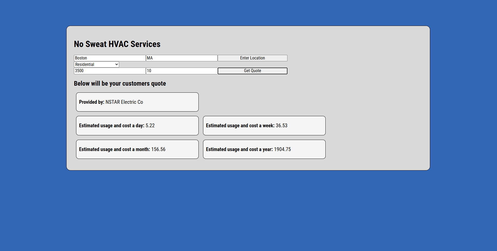

# HVAC Utility Rates

A simple front-end web app for HVAC technicians and contractors. Enter a location and it shows the local electric utility and its average electricity rates, so you can estimate running costs for a customer's heating and cooling system.

## Why It's Useful

When an HVAC tech recommends a new system, one of the first things a customer asks is how much it will cost to run. Electricity prices vary a lot from place to place. This app looks up the actual rates for the job site, so the tech can give a real estimate instead of a guess.

## How It Works

1. The user enters a location.
2. The app sends a request to the Utility Rates API from the National Laboratory of the Rockies (formerly NREL).
3. The results are displayed on the page: the utility company that serves the area and its average residential, commercial, and industrial electricity rates in $/kWh.

## How It's Made

**Tech used:** HTML, CSS, JavaScript

**API:** [Utility Rates API](https://developer.nlr.gov/api/)

The page is built with HTML and styled with CSS. JavaScript takes the location the user enters, uses the Fetch API to request utility rate data, parses the JSON response, and updates the DOM with the results.