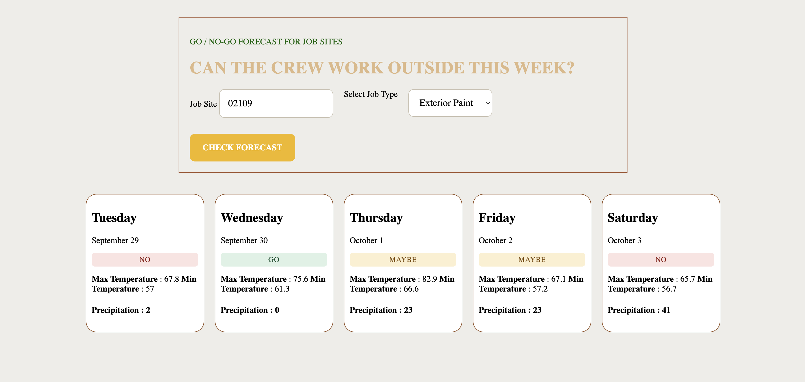

# Pour Day

Pour Day is a lightweight construction weather planner. Enter a job-site city and choose a type of outdoor work to see a five-day forecast with a **GO**, **MAYBE**, or **NO** recommendation for each day.

## Demo

## Work types

- **Pour Concrete**: considers minimum temperature and precipitation probability.
- **Exterior Paint**: considers minimum and maximum temperature, precipitation probability, and humidity.
- **Roofing**: considers minimum temperature and precipitation probability.
- **Crane Lift**: considers wind gusts and precipitation probability.

Each forecast result also shows the date, daily high and low temperatures in Fahrenheit, and precipitation probability.

## Project files

- `index.html`: page structure and job-type selector.
- `css/style.css`: page and forecast-card styles.
- `js/main.js`: city lookup, weather request, work-status rules, and forecast rendering.

## Notes

Forecast recommendations are simple guidance based on the conditions returned by the weather API. They are not a substitute for site-specific safety procedures or professional judgment.
