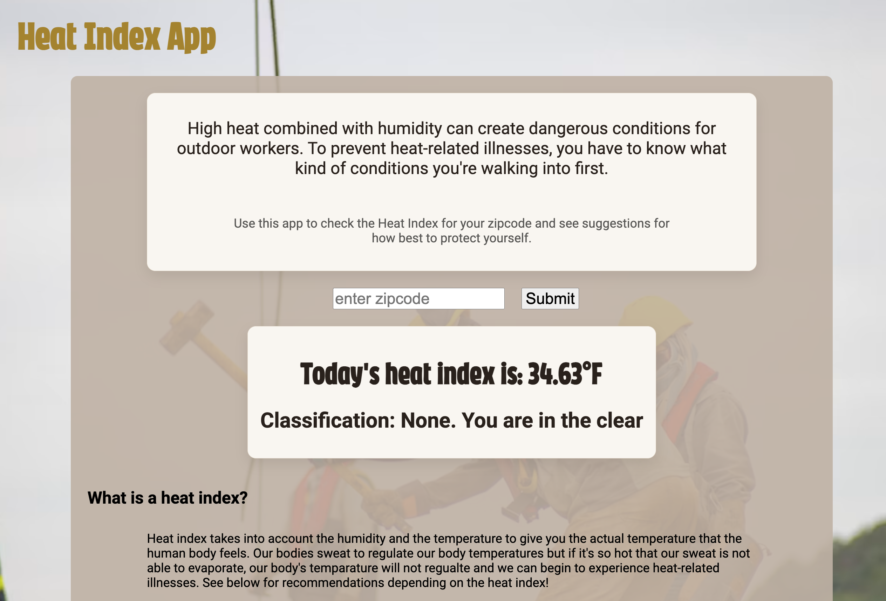

# 🌡️ Heat Index App

An app for construction workers and outdoor workers generally to check the heat index for a zip code and see recommendations for how to protect their health. Built with HTML, CSS, and Vanilla JavaScript.

### Project Description

This project is a heat index recommendations app. It gives the user a search bar to enter a zip code, fetches the current conditions for that area from OpenWeatherMap API, and prints the 'feels-like' temperature in Fahrenheit along with a heat index classification. 

Below the results is a reference table of recommendations for each classification, from "None" up to "Extreme Danger," covering water intake, gear, breaks, and monitoring for outdoor workers.

The National Weather Service in the US shares "The heat index, also known as the apparent temperature, is what the temperature feels like to the human body when relative humidity is combined with the air temperature." Our bodies sweat to cool down. If the weather outside is so hot AND humid that our sweat isn't able to evaporate, our bodies can overheat and we can fall victim to heat-related injuries.

This app is a simple front-end app that displays data returned from an API that would be beneficial to someone in the trades (construction, HVAC, plumbing, etc.). The styling is bold and high-contrast so the classification is readable at a glance.

### Live Link
To run the app, [click here](https://priscilla-ruilova.github.io/Heat-Index-App/) or follow the link the About section of this repo.



### Features:

- **Zip code search** — type a zip code into the search bar and click **Submit** to check that area.
- **Heat index** — displays the feels-like temperature in Fahrenheit, rounded to two decimals. E.g.: `Today's heat index is: 88.00°F`.
- **Classification** — displays the matching classification under the temperature: None, Caution, Extreme Caution, Danger, or Extreme Danger.
- **Recommendations table** — a reference chart at the bottom of the page lists guidance for each classification.
- **Static Page** — one `index.html`, no build step, no dependencies to install.

### Tech Used:

- **Frontend:** HTML, CSS, JavaScript (vanilla, no framework)
- **API:** [OpenWeatherMap](https://openweathermap.org/current) — `weather` endpoint
- **Browser APIs:** `fetch`, `document.querySelector`, `addEventListener`
- **Hosting:** GitHub Pages

### Things I Learned:

- Working with an API:
  - Chaining `fetch(url)` → `.then(res => res.json())` → `.then(data => ...)` and read values out of the response, like `data.main.feels_like`.
  - That OpenWeatherMap returns temperatures in Kelvin by default, so I wrote the conversion to Fahrenheit myself: `(kelvin - 273.15) * (9/5) + 32`.
  - How to handle a failed request with `.catch()` so the app doesn't fail silently.
- Conditional logic:
  - How to use `if / else if / else` chains to map a numeric range to a label, and how to order the conditions so each range is checked correctly.
- Debugging:
  - Using `console.log(data)` to inspect the full API response before writing code against it.

### How to Use:

1. Clone this repository or the one I forked from above:
```bash
git clone https://github.com/priscilla-ruilova/Heat-Index-App.git
```

2. Navigate to the project:
```bash
cd Heat-Index-App
```
3. Open `index.html` in your browser — no install step needed.

4. Make it your own!
- Swap in your own API key from [openweathermap.org](https://openweathermap.org/) in `assets/main.js`.
- Consider adding a geocoding step so users can enter an address or city instead of a zip code, and match it to its coordinates before the weather request.
- Try changing the styling in `assets/styles.css` to make it your own.

### Note: For employers of outdoor workers

There are many resources for employers to use to ensure the safety of outdoor workers. Consider the following resources:
- [National Weather Service](https://www.weather.gov/ama/heatindex)
- [Occupational Safety and Health Administration (OSHA)](https://www.osha.gov/heat-exposure)
- [Safe at Work California: An Employer's Guide [video]](https://www.safeatworkca.com/videos/heat-illness-prevention-an-employers-guide/)
- [ERA-Environmental Blog Post: Health and Safety Planning Under OSHA's Heat Illness Regulations 2024](https://www.era-environmental.com/blog/osha-heat-illness-health-and-safety)

## Happy Coding!