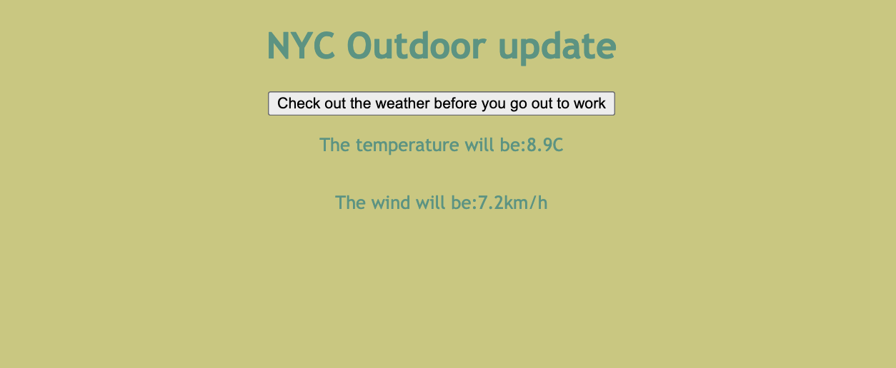

# NYC Outdoor Update

A simple weather app for construction workers and anyone working outdoors in New York City. Check forecast temperature and wind speed before heading to work.

## How it looks like:

- Chech out here:
https://construction-chi-lac.vercel.app/

- Screenshot:



## About

Outdoor work means planning around the weather. NYC Outdoor Update provides a simple interface for checking weather information for New York City.

This project was built as part of the Resilient Labs Simple API Construction challenge: create a front-end application that uses API data to benefit people working in the trades.

## Features

- Fetch weather data with a button click.
- Display forecast temperature in Celsius.
- Display forecast wind speed in kilometers per hour.
- Use a fixed New York City location.
- Access weather data without an API key.

## Built With

- **HTML** — page structure
- **CSS** — styling
- **JavaScript** — interactions and DOM updates
- **Fetch API** — weather data requests
- **Open-Meteo API** — weather forecasts
- **Vercel** — hosting

## Getting Started

Clone the repository:

```bash
git clone https://github.com/sabrinalindev/construction.git
cd construction
```

Open `index.html` in your browser, or serve the project using your editor’s local development server.

No npm installation or build step is required.

## Usage

1. Open the app.
2. Click **“Check out the weather before you go out to work.”**
3. View the temperature and wind speed displayed below the button.

## Weather Data

The app requests hourly forecasts from [Open-Meteo](https://open-meteo.com/) using these settings:

| Setting | Value |
|---|---|
| Location | New York City |
| Coordinates | 40.7128, -74.0060 |
| Time zone | America/New_York |
| Displayed measurements | Temperature and wind speed |

The current implementation displays the **first hourly entry returned by the API**, which may differ from the current hour. Precipitation probability is requested but is not yet displayed.

## Planned Improvements

- Select the forecast entry matching the current hour.
- Display the forecast date and time.
- Show precipitation probability.
- Add loading and error messages.
- Support Fahrenheit and Spanish.
- Allow users to choose other locations.

## Acknowledgments

- [Open-Meteo](https://open-meteo.com/) for weather data.
- [Resilient Labs](https://github.com/Resilient-Labs/simple-api-construction) for the original project challenge.

## Author

[Sabrina Lin](https://github.com/sabrinalindev)