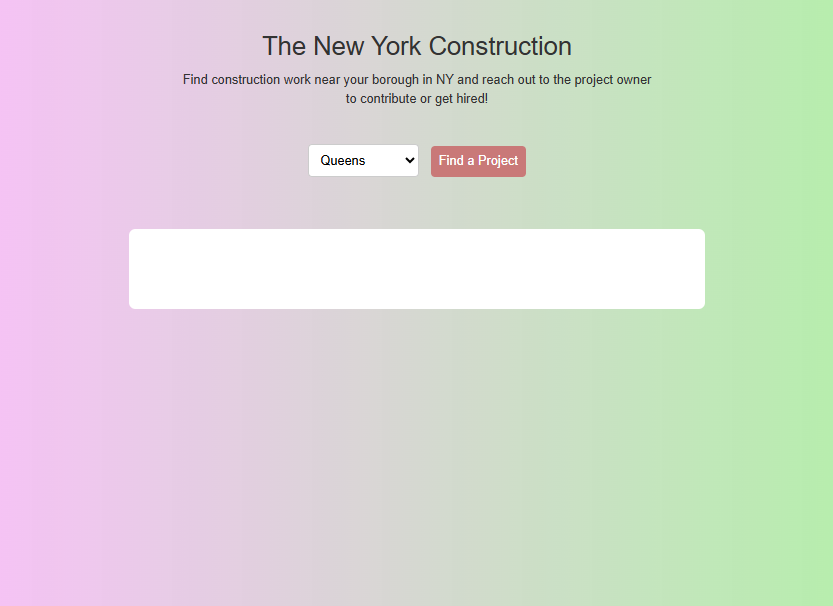
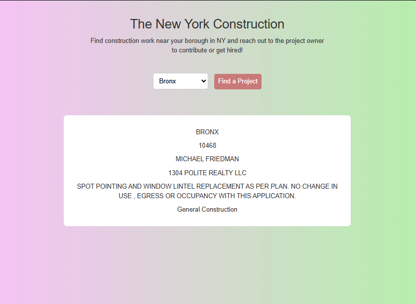

# Construction App
Goal: Build a simple front-end app that displays data returned from an api that would be beneficial to someone in the trades (construction, hvac, plumbing, ect)

## View

  
  

## Built With

- HTML5
- CSS3
- Vanilla JavaScript

## Local Preview

Open `index.html` using the VS Code Live Server extension or open the file directly in your browser.

## Limits

This is only limited to the 5 boroughs of NYC. Queens, Brooklyn, Bronx, Manhatta, Staten Island. 
It only loads One project. 
Flow: Search By borough, Find a random project, the owner and company, reach out to contribute to the project! 

